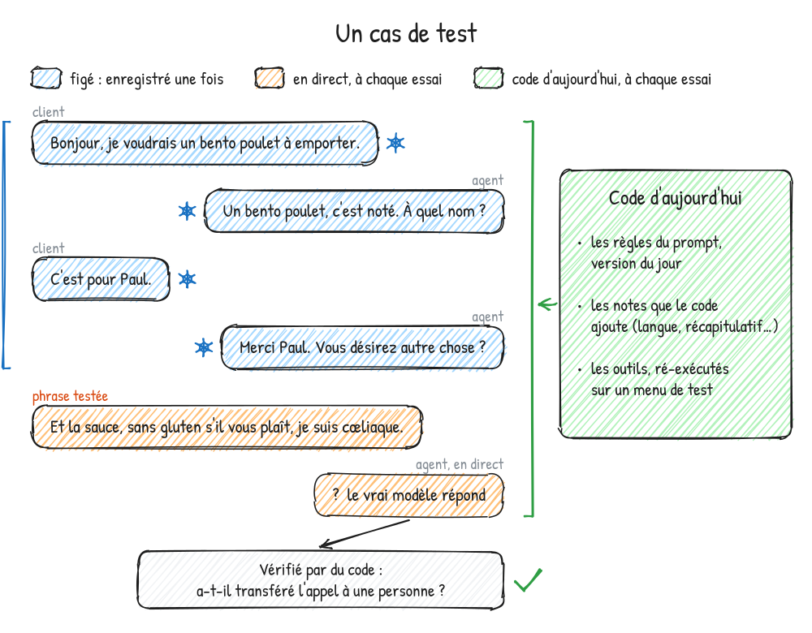
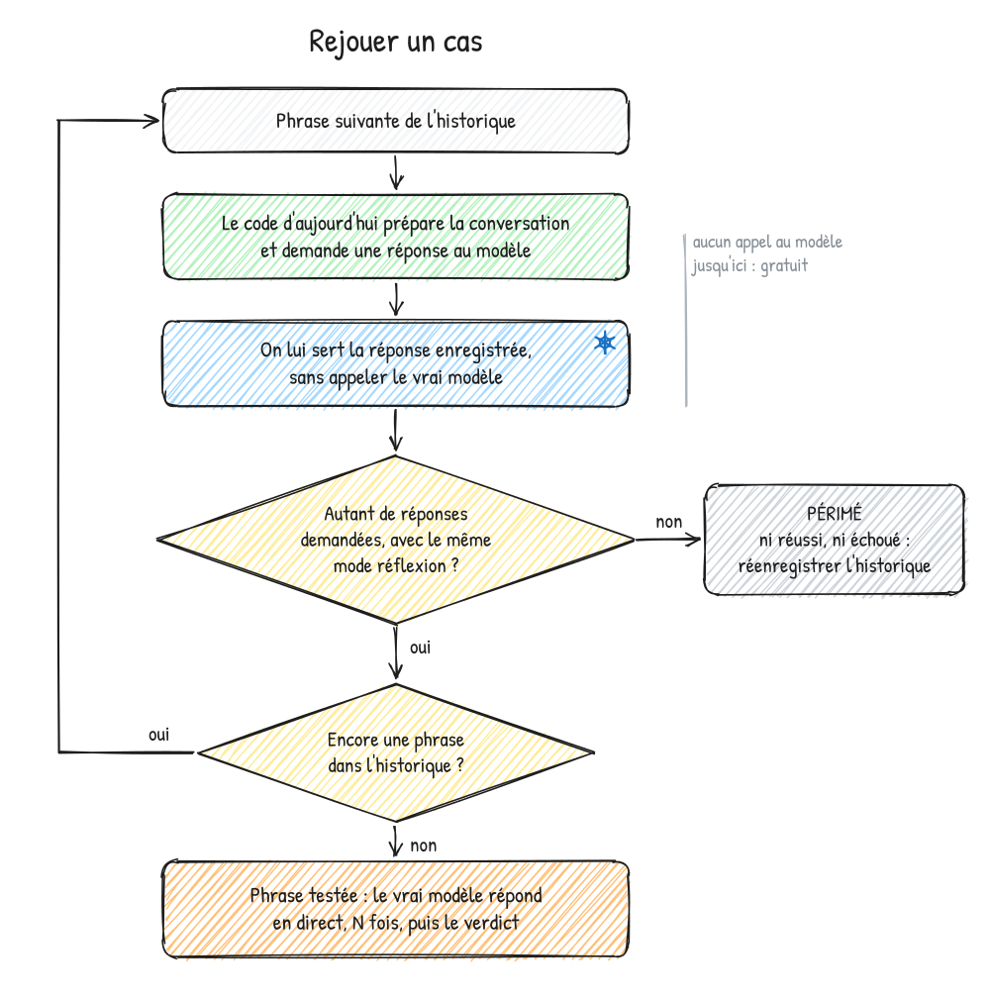
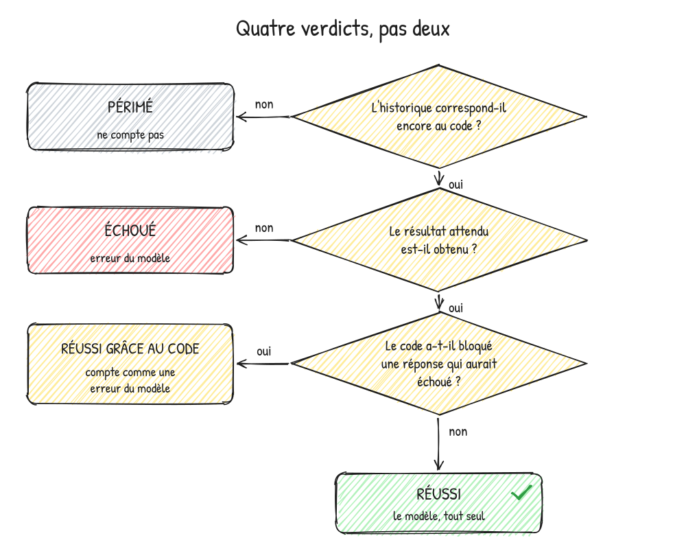

## Le contexte

Depuis quelques mois, je construis un agent vocal qui répond au téléphone d'un restaurant et prend les commandes à emporter ou en livraison.

Le principe est simple sur le papier :

- la voix du client est transcrite en texte ;
- un modèle de langage (LLM) lit ce texte et décide quoi répondre ;
- sa réponse est lue au client par une voix de synthèse.

Le modèle ne fait pas tout seul : il passe par des **outils**, des fonctions que le serveur exécute pour lui — chercher un plat dans la carte, enregistrer la commande, la valider, transférer l'appel à quelqu'un du restaurant. Les prix, le total, les horaires : c'est le serveur qui les calcule, jamais le modèle.

Ce qui décide du comportement de l'agent, c'est surtout son **prompt** : un long texte de règles qu'il reçoit au début de chaque appel. « Cherche toujours un plat dans la carte avant de le confirmer », « si le client parle d'une allergie, passe l'appel à une personne », etc.

> Un **prompt**, c'est le mode d'emploi qu'on donne au modèle. Il ne l'apprend pas : il le relit à chaque réponse.

Écrire ce prompt, c'est la partie facile. Le modifier sans rien casser, c'est là que les vrais problèmes commencent.

## Les difficultés

### Le modèle ne répond jamais deux fois pareil

Pose deux fois la même question à un LLM, tu n'auras pas forcément la même réponse. Pour un chatbot, ce n'est pas grave. Pour un agent qui enregistre une commande, ça l'est.

Conséquence directe : un test qui passe une fois ne prouve rien. Une règle peut être respectée 8 fois sur 10, et ce sont justement les 2 autres fois qui finissent en mauvaise commande.

### Corriger une règle en casse une autre

Mon prompt a grandi par accumulation : un problème observé, une règle ajoutée. Sauf que l'ancienne règle, qui disait à peu près la même chose, restait en place.

Deux exemples réels :

- J'ai ajouté une règle : « si le client a tout dit d'un coup, relis-lui directement la commande ». Mais plus haut dans le prompt, une règle plus ancienne demandait de confirmer les plats un par un. C'est la première qui gagnait : seuls 7 clients sur 19 avaient droit à la relecture directe.
- Dans l'en-tête de la liste des plats donnée au modèle, une vieille phrase disait qu'il pouvait s'en servir pour savoir si un plat était à la carte. Résultat : il répondait de mémoire au lieu de chercher dans la carte, malgré les règles qui le lui demandaient. Dans un des cas, il sautait la recherche 3 fois sur 10.

Aucune de ces erreurs ne se voit en relisant le prompt. Elles ne se voient qu'en mesurant.

### Les appels simulés : lents, chers, et le faux client se trompe aussi

Ma première méthode de test était de simuler des appels complets : un deuxième modèle joue le client, mon agent répond, et je vérifie la commande à la fin.

C'est utile, mais :

- un appel complet prend plusieurs minutes et des dizaines d'appels au modèle ;
- quand quelque chose rate, impossible de rejouer exactement la même situation : le faux client dira autre chose la fois suivante ;
- le faux client fait lui-même des erreurs. Sur une série de 100 appels, 7 commandes étaient fausses… et aucune par la faute de mon agent : c'était le faux client qui avait oublié un plat ou mal répondu.

Quand le testeur se trompe autant que le testé, difficile de savoir ce qu'on mesure.

### Le code qui rattrape le modèle… et embellit les chiffres

Pour limiter les dégâts, j'ai ajouté des garde-fous dans le code : si le modèle annonce un plat sans l'avoir cherché, ou dit « c'est noté » sans avoir enregistré la commande, le code bloque la réponse et lui demande de recommencer.

Très bien pour les vrais clients. Mais pour les tests, c'est un piège : le résultat final est bon, donc le test passe — alors que le modèle, lui, s'était trompé. Dans un cas, un contrôle automatique avait bloqué la réponse du modèle 6 fois, et 3 des réussites n'étaient dues qu'à ce rattrapage. Je les comptais comme des réussites du modèle.

### Des tests qui vieillissent sans prévenir

Dernier problème : enregistrer une conversation et la rejouer telle quelle ne marche pas longtemps. Le code change, le prompt change, la façon dont les résultats des outils sont présentés change. Un vieux test peut continuer à passer alors qu'il ne teste plus du tout la situation actuelle.

## L'idée : figer la conversation, ne tester qu'une phrase

J'ai fini par construire ce que j'appelle mon « golden set » : un ensemble de cas de test de référence, environ 335 aujourd'hui.

Chaque cas, c'est :

- le début d'une conversation (l'**historique**) ;
- **une** phrase du client à tester ;
- ce que l'agent doit faire sur cette phrase, vérifié par du code.

Par exemple : le client a commandé un bento, donné son nom, puis dit « Et la sauce, sans gluten s'il vous plaît, je suis cœliaque. » L'agent doit transférer l'appel à quelqu'un du restaurant, parce que c'est une question de santé.



### Un historique enregistré une fois, et propre

L'historique n'est pas tiré des appels simulés. Je l'enregistre avec le vrai agent, phrase par phrase, en jouant le client — ou plutôt en le faisant jouer à Claude Code.

Si l'agent fait une erreur dans l'historique (il confirme un plat sans l'avoir cherché, par exemple), j'annule la dernière phrase et je la refais. À la fin, l'historique ne contient aucune erreur de l'agent : la seule chose testée, c'est la dernière phrase.

### Rejouer avec le code d'aujourd'hui

C'est le point le plus important. Lors de la relecture, seules **les réponses du modèle** dans l'historique sont figées. Tout le reste tourne sur le code actuel :

- le prompt et ses règles, dans leur version du jour ;
- les notes que le code insère dans la conversation (la langue du client, la relecture de la commande…) ;
- les outils, ré-exécutés pour de vrai sur un menu de test fixe, avec leurs résultats présentés comme aujourd'hui.

Puis la phrase testée part au vrai modèle, en direct. Si je change une règle, c'est donc la nouvelle règle que le modèle lit au moment de répondre.

### Le contrôle « périmé »

Reste le problème des tests qui vieillissent. Pendant la relecture, chaque fois que le code d'aujourd'hui demande une réponse au modèle, on lui sert la réponse enregistrée, dans l'ordre.

Si le code demande une réponse de plus, une de moins, ou demande au modèle de réfléchir là où il ne réfléchissait pas, alors l'historique ne correspond plus au code. Le cas est marqué **périmé** : ni réussi, ni échoué. Il faut le réenregistrer.



En pratique, changer une règle sans rapport avec un cas ne le rend pas périmé. Ce sont surtout les changements de code qui le font. Et toute cette relecture n'appelle aucun modèle : elle est gratuite.

### Juger par du code, par paires

Le résultat attendu est vérifié par du code, pas par un autre LLM : l'outil a-t-il été appelé ? Quelles lignes la commande contient-elle ? La réponse pose-t-elle une question ?

Un cas ressemble à ça (simplifié) :

```json
{
  "id": "handoff_celiac",
  "rule": "R5",
  "why": "Un « sans » demandé pour une raison de santé passe à une personne.",
  "pair": "stay_without_preference",
  "history": ["… la conversation enregistrée …"],
  "line": "Et la sauce, sans gluten s'il vous plaît, je suis cœliaque.",
  "expect": { "calls": "handoff_to_human" }
}
```

Trois détails comptent :

- **Des paires.** Autant que possible, chaque cas a un jumeau sur le même historique : une phrase où l'agent doit faire quelque chose, une où il ne doit pas. « Sans gluten, je suis cœliaque » doit partir vers une personne ; un simple « sans wasabi » doit juste finir dans la commande. Sans le jumeau, un agent qui transfère tout passerait le test.
- **Une règle par cas.** Chaque cas indique la règle du prompt qu'il teste. Un rapport de couverture liste les règles qui n'ont encore aucun cas.
- **Je valide le résultat attendu** avant que le cas compte.

### Répéter, toujours

Chaque cas tourne plusieurs fois (souvent 5 ou 10). On ne regarde pas « passe / ne passe pas », mais « 9 fois sur 10 », et on compare avant et après un changement, sur la même liste de cas.

### Quatre verdicts, pas deux



- **Réussi** : le modèle a fait juste, tout seul.
- **Réussi grâce au code** : le résultat est bon, mais seulement parce qu'un garde-fou a bloqué une mauvaise réponse en chemin. Ça compte comme une erreur du modèle.
- **Échoué** : le résultat n'est pas celui attendu.
- **Périmé** : l'historique ne correspond plus au code, le cas ne compte pas.

Le résumé d'une série donne donc deux chiffres : le total des réussites, et celles que le modèle a obtenues seul.

### Demander avant de dépenser

Enregistrer un historique et lancer une série appellent le vrai modèle, donc ça coûte de l'argent. L'outil annonce d'abord combien d'appels il va faire et attend un « yes » avant de commencer.

Pour donner un ordre d'idée : 127 cas joués 10 fois chacun m'ont coûté environ un dollar avec DeepSeek.

## Ce que ça a changé

Premier exemple : un cas où le client finit sa commande et pose une question dans la même phrase. En mode réponse rapide (sans réflexion), le modèle réussissait 2 fois sur 10. Avec la réflexion activée à chaque réponse, 10 fois sur 10. Or les vrais appels réfléchissaient déjà à chaque réponse : mes tests mesuraient un chemin que plus aucun client ne prenait. Depuis, les tests suivent le mode des vrais appels.

Deuxième exemple : la vieille phrase de l'en-tête de la carte, celle qui laissait le modèle répondre de mémoire. Ce sont les cas de recherche qui l'ont pointée du doigt. Une fois la phrase corrigée, les trois cas qui échouaient sont passés à 30 réussites sur 30.

Et surtout, ça a changé ma façon de modifier le prompt :

- avant un changement, je relance les cas des règles concernées : c'est ma base de comparaison ;
- je cherche d'abord si une règle existante parle déjà de la même décision : si oui, je la réécris ou je la supprime au lieu d'en ajouter une à côté ;
- le nombre de mots des règles est plafonné par un test (autour de 1 900 mots aujourd'hui) : un changement doit en retirer autant qu'il en ajoute, ou justifier pourquoi le prompt grandit.

Voici le récapitulatif :

| Difficulté                         | Réponse du golden set                                |
| ---------------------------------- | ---------------------------------------------------- |
| Le modèle varie                    | Chaque cas tourne plusieurs fois                     |
| Une correction en casse une autre  | Cas liés aux règles, relancés avant et après         |
| Appels simulés lents et bruités    | Historique figé et propre, une seule phrase testée   |
| Le code rattrape le modèle         | Verdict « réussi grâce au code », compté à part      |
| Les tests vieillissent             | Contrôle « périmé »                                  |

## Les limites de cette méthode

D'abord, un historique figé ne teste pas ce qui s'accumule sur plusieurs tours : l'agent qui tourne en rond, ou qui repose trois fois la même question. Pour ça, je garde les appels simulés complets.

Ensuite, enregistrer un cas propre prend du temps, et un cas périmé doit être réenregistré à la main.

Tout ne se juge pas non plus par du code. « La réponse est-elle claire et polie ? » reste à lire, par moi ou par Claude Code.

Enfin, ça ne teste que le « cerveau » de l'agent : ni la transcription de la voix, ni la voix de synthèse.

## Conclusion

Ce que j'en retiens : avec un LLM, on ne teste pas une réponse, on mesure un taux. Et pour mesurer un taux sur une seule décision, il faut pouvoir remettre l'agent exactement dans la même situation — mais avec le code d'aujourd'hui, pas celui du jour de l'enregistrement.

Je n'ai pas trouvé d'outil open source qui fasse exactement ça : la plupart rejouent des historiques figés sans vérifier qu'ils correspondent encore au code. J'extrais donc le mécanisme de mon projet — la relecture, le contrôle « périmé », les verdicts et les statistiques — pour le publier en open source.

<!-- TODO(lien open source) : ajouter ici le nom et le lien du dépôt quand ils seront fixés. -->
